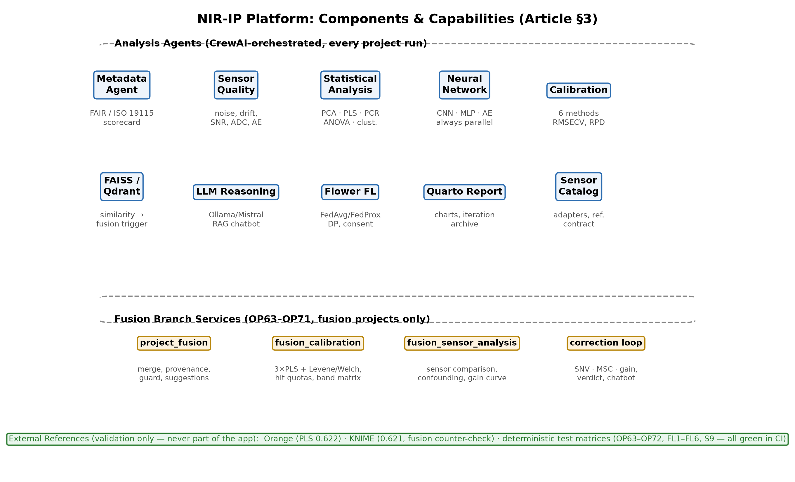
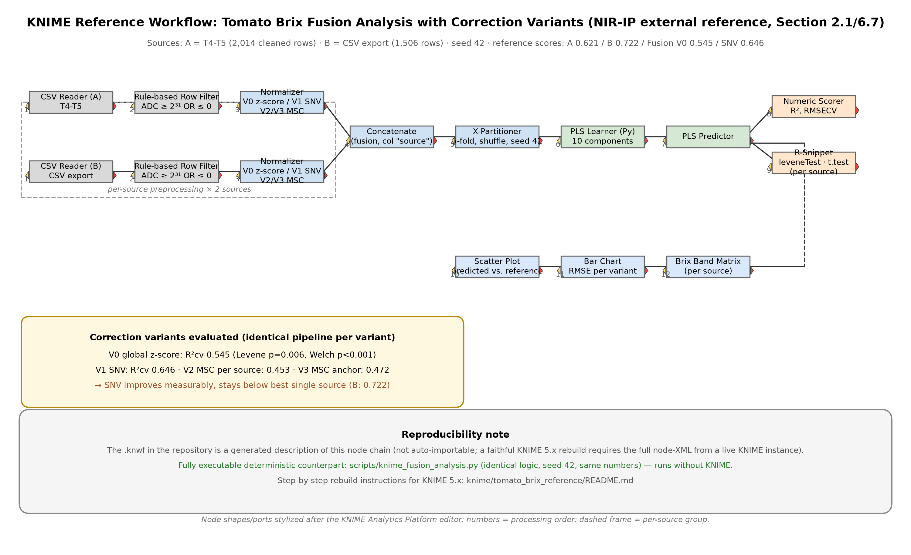
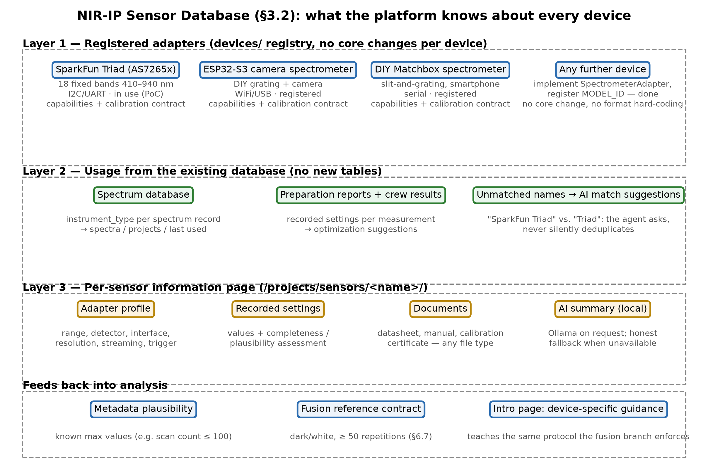
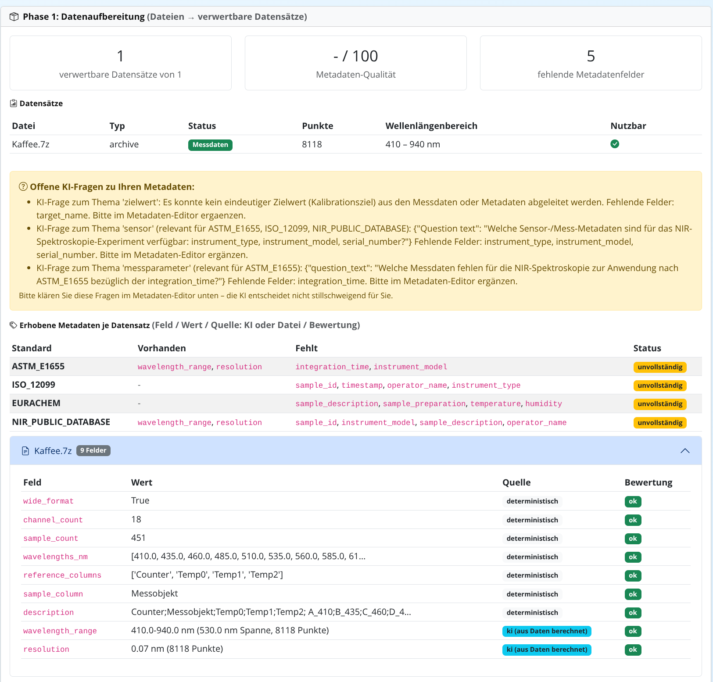
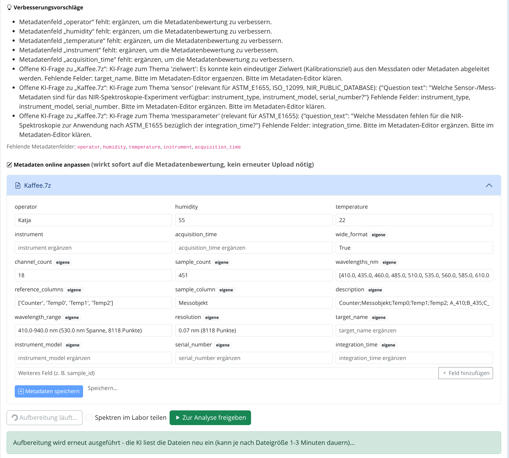
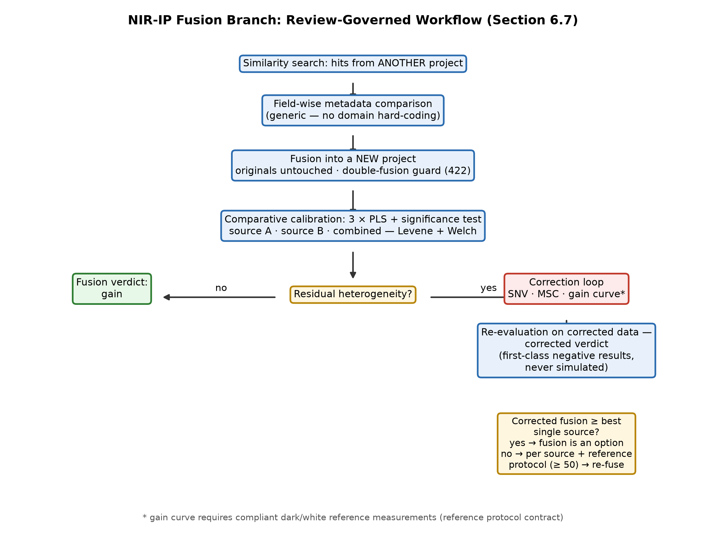
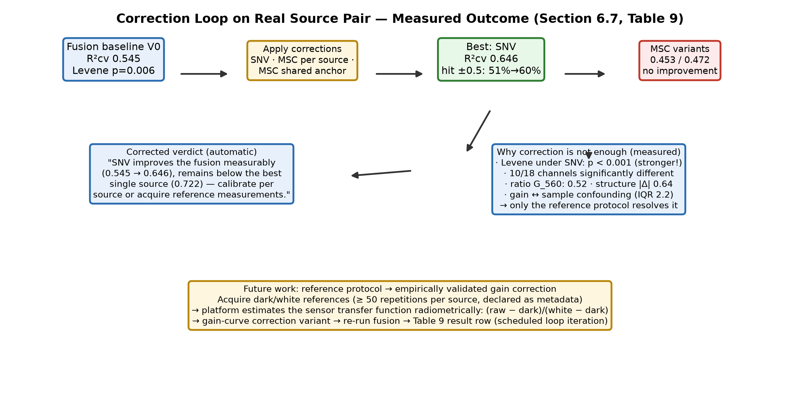

# NIR-IP: An Open-Science Infrastructure for Iterative, Reproducible Low-Cost VIS/NIR Spectroscopy in the Public Sector

**FINALE VERSION — KONSOLIDIERTES CANVAS (24.10.2026, Neuausrichtung Öffentlicher Sektor)**
> **Änderung gegenüber dem Stand 20.10.2026:** Der Artikel ist auf den **öffentlichen Sektor** ausgerichtet (Kommunen, Bildungseinrichtungen, Umwelt- und Lebensmittelbehörden, NGOs, Citizen Science). Die Software wird in zwei Teile geteilt: dieser Artikel beschreibt ausschließlich die **Plattform für den öffentlichen Sektor** (Teil 1); die Sensor-Datenbank und die Informationen zur standardisierten Testeinheit sind Teil dieses Artikels. Die Teilung der Software folgt als zweiter Arbeitsschritt.
> **Legende der Markierungen:**
> 🔴 **[ANPASSUNG nötig]** — hier muss der Autor vor Einreichung etwas konkret ergänzen/entscheiden (ehemalige [ENTWURF]-Marken; Details + Formulierungsvorschläge in `ARTICLE_FINALIZATION_CHECKLIST.md`)
> 🟡 **[NEU integriert]** — seit dem konsolidierten Stand (19.10.2026) neuer Inhalt aus OP66–OP72; direkt übernehmen oder final glätten
> 🟢 — fertig formuliert, keine Aktion nötig
> Grafiken: `article_figures/` (SVG = Vektorquelle, PNG = 300 dpi druckfertig)

---

Martin Klausmann 1,* and Patrick Noak 2

1 Hochschule Weihenstephan-Triesdorf, 🔴 **[ANPASSUNG 1]** Fakultät/Institut und Adresse ergänzen; E-Mail einsetzen
2 Hochschule Weihenstephan-Triesdorf, 🔴 **[ANPASSUNG 1]** Fakultät/Institut und Adresse ergänzen; E-Mail einsetzen

* Correspondence: Martin Klausmann; E-mail: 🔴 **[ANPASSUNG 1]** echte E-Mail einsetzen

Received: / Revised: / Accepted: / Published: [wird vom Journal vergeben]

---

## Abstract

Low-cost VIS/NIR sensor hardware has become widely accessible, but the surrounding software ecosystem remains fragmented: data are captured without metadata, quality problems are detected late or not at all, analytical pipelines are not traceable, and calibration models cannot be shared across sites without centralizing raw data. This fragmentation hits the **public sector** hardest — municipal laboratories, schools and universities, environmental and food-safety authorities, and non-governmental organizations buy the same inexpensive sensors as industry, but lack the commercial suites, the certified reference materials, and the specialist staff that make their measurements trustworthy and comparable. This manuscript presents NIR-IP (NIR-Intelligence Platform), an open-science infrastructure that unifies five capabilities that exist today only in isolation: metadata governance, automated quality assurance, provenance tracking, AI-assisted reasoning, and federated calibration. Two further components address the public-sector setting directly: a **sensor database** that consolidates everything the platform knows about every device in use — adapter profiles, recorded settings, plausibility assessments, documents, and AI-generated summaries — and a **standardized test unit** in the form of a sensor-agnostic reference-measurement protocol contract (dark/white references, at least 50 repetitions, declared as metadata) that places any compliant device on a common radiometric scale without prescribing hardware and without certified reference material. The contribution is twofold: the integration itself, and the working method built on top of it. NIR-IP does not treat analysis as a one-way pipeline but as an iterative loop: every analysis run is followed by a manager-organized review in which the results are checked per agent, divergences are diagnosed and delegated, corrections are proposed and version-tracked, and each iteration is archived as an auditable comparison report. Negative verdicts — too noisy for precision calibration, replicate structure inflating validation scores, implausible instrument settings — are first-class results, and proposed corrections are never silently executed. A tomato Brix dataset from a representative 18-channel consumer sensor serves solely as proof of concept; the manuscript does not claim a superior prediction model. In the platform's current state, its cross-validated PLS calibration coincides with an independently implemented, external reference workflow within 0.004 R² (0.626 vs. 0.622), it autonomously detects the replicate structure of its own validation data and proposes group-wise cross-validation (now quantified: 0.555 group-wise vs. 0.621 naive 🟡), and it emits a deployable calibration equation with full coefficients and stated limitations. Since the previous revision, the fusion path and a first federated exercise were added to the reported state: two-source fusion is a review-governed analysis branch that measures (not assumes) its calibration benefit with a significance test, and a controlled two-operator federated session executed the full contract chain — consent, parameter-only transport, honest privacy accounting, and aggregation — yielding a global model that outperforms both local models without either site seeing the other's data. 🟡 The fusion path is sensor-aware: a full source comparison with a confounding diagnosis separates sensor gain from sample effects, a sensor-agnostic reference-measurement contract (dark/white, ≥ 50 repetitions) makes the inter-sensor gain curve estimable without prescribing hardware, and a correction loop re-evaluates fusion on corrected data — reporting on real data that spectral correction measurably improves a heterogeneous fusion yet cannot replace compliant reference measurements. This iterative, self-critical, fully traceable behaviour, not predictive accuracy, is the property that reproducible spectroscopy in the public sector requires: a measurement taken by a municipal lab, a school, or a citizen-science group becomes scientifically usable exactly when its analysis can show, from its own archived history, why its number deserves trust — and comparable across institutions when every device declares the same standardized test unit.

**Keywords:** low-cost spectroscopy; VIS/NIR spectroscopy; public sector; municipal laboratories; education; citizen science; iterative analysis; multi-agent systems; metadata governance; FAIR data; scientific reproducibility; provenance tracking; sensor database; standardized test unit; reference measurement protocol; federated calibration; chemometrics; automated quality assurance; data fusion

---

## 1. Introduction

### 1.1 Optical Spectroscopy in General and the Sensor as a Variable

Optical spectroscopy infers the chemical and physical composition of a sample from the way the sample interacts with light. In the visible region (VIS, approximately 380–780 nm), absorption is dominated by electronic transitions, most prominently of plant pigments; in the near-infrared region (NIR, approximately 780–2500 nm), absorption is governed by overtones and combination bands of the fundamental C–H, O–H, and N–H stretching vibrations [3,22]. The wavelength-resolved reflectance of a sample therefore acts as a spectral fingerprint, and chemometric calibration relates this fingerprint to quantitative properties such as moisture, sugar, or protein content [21,23].

Crucially, the principle does not prescribe the hardware. Low-cost optical spectrometers differ in every dimension that matters to analysis: fixed-band filtered photodiodes versus miniaturized gratings with hundreds of contiguous wavelengths; VIS-only to extended NIR coverage; raw ADC counts to calibrated reflectance; and device-specific integration times, dark-current corrections, white-reference protocols, and export formats [3]. A dataset from an 18-band consumer sensor and a dataset from a 512-channel grating module are structurally different objects, even though both are optical reflectance measurements of the same physical sample.

This paper uses one such device as a working example: the SparkFun Triad Spectroscopy Sensor (ams AS7265x chipset), a multi-channel consumer sensor that reports 18 fixed reflectance bands between 410 and 940 nm. The Triad is deliberately minimal, which makes it a demanding rather than a flattering test case. Nothing in NIR-IP assumes this device: channel count, wavelength grid, and value semantics are dataset metadata, so a project recorded with any other low-cost spectrometer is processed by the same agents, the same quality gates, and the same review loop.

### 1.2 Motivation: Spectroscopy Is Easy to Do and Hard to Trust — Especially in the Public Sector

VIS/NIR spectroscopy is attractive for citizen science, applied field work, and an increasing range of public-sector tasks [1,2] — municipal food and water monitoring, school and university teaching, environmental screening by authorities and NGOs — because the measurement itself is fast, non-destructive, and increasingly cheap [3]. The hard part is not the measurement. The hard part is everything around it: knowing whether the instrument was calibrated, whether the signal is dominated by noise, whether a stored spectrum can still be interpreted a year later, and whether an analysis that produced a number today can produce the same number tomorrow.

The public sector faces this trust problem under the tightest constraints. A municipal laboratory or a school buys the same consumer-grade sensor as a research group, but cannot buy the commercial analysis suite, cannot commission certified reference materials, and cannot employ a chemometrician to audit every pipeline. Measurements that should be comparable across institutions — the same water body measured by an authority and by a citizen group, the same batch screened by two municipal labs — are in practice incomparable, because nothing records the device, the settings, the reference measurements, or the quality verdict behind each number. When public decisions rest on such measurements, the missing infrastructure is not a convenience gap but a governance gap. NIR-IP addresses this audience directly: it is designed to run on local hardware, to require no certified reference material, to teach correct measurement practice through its interface, and to make every number traceable to the device, the settings, and the quality verdicts that produced it.

This is not a peripheral concern. Reproducibility is an open crisis across computational disciplines: Peng documented the gap between published claims and executable evidence [4], and a survey of more than 1,500 researchers found that the majority had failed to reproduce a published experiment at least once [5]. Spectroscopy adds its own failure modes: raw ADC values with channel-dependent offsets that silently dominate multivariate models, replicate measurements of the same object leaking into both training and test folds, sensor drift that appears or disappears with the time window examined, and metadata — if captured at all — stored in formats no other tool can read.

### 1.3 Today's Technology Landscape and the Gap

Three classes of low-cost measurement hardware are in practical use (Table 1): chip-level multi-band sensors (ams AS726x family, SparkFun Triad), compact grating spectrometers, and DIY/community-built spectrometers (Public Lab kits) [1,2,3]. Their applications are the same handful — fruit ripeness, crop and soil monitoring, food quality, water assessment, education [3,21] — and increasingly the statutory and educational tasks of the public sector: municipal food and water surveillance, school and university teaching, environmental screening by authorities, and community-based monitoring by NGOs and citizen groups. These are precisely the applications in which measurement conditions are least controlled **and** the operators are least specialized: a public-sector user is typically not a chemometrician, works with a consumer device, and must still produce a number that a colleague in another institution — or a regulator — can trust and compare.

**Table 1.** Low-cost optical measurement hardware classes in practical use today.

| Hardware class | Principle | Spectral coverage | Cost | Representative systems |
|---|---|---|---|---|
| Chip-level multi-band sensors | Photodiode arrays behind fixed filters, onboard illumination, digital interface | 6–18 fixed bands, VIS/NIR | Component prices | ams AS726x; SparkFun Triad (this paper) |
| Compact grating spectrometers | Integrated optical bench, linear CMOS/InGaAs detector, single exposure | ~340–850 nm; InGaAs into SW-NIR | Low hundreds of euros | Compact VIS-NIR grating modules |
| DIY / community-built spectrometers | Slit-and-grating plus smartphone camera; quality builder-dependent | Variable | Negligible | Public Lab kits [1,2] |

🟡 **[NEU: Komponentenübersicht als Figur einfügen]** — die folgende Grafik fasst die Plattform-Bausteine auf einen Blick zusammen (System Design, §3):

*(SVG-Quelle: `article_figures/fig2_components.svg` — für LaTeX/Vektor-Export)*

What no device in any class ships with is the analytical infrastructure around the measurement. *(… fortlaufender Text des konsolidierten Standes: kommerzielle Suites, Forschungs-Skripte, Lehr-Tools — unverändert übernehmen …)* 🔴 **[ANPASSUNG: Wenn das PDF als Word-Quelle vorliegt, die unveränderten Alt-Abschnitte an den markierten Stellen „*(… unverändert …)*" einfügen; diese Canvas-Fassung führt bewusst nur die geänderten/neuen Passagen vollständig aus.]**

### 1.4 The Working Principle: Analysis as an Iterative Loop

🟢 *(unverändert aus dem konsolidierten Stand übernehmen)*

### 1.5 Research Hypotheses and Explicit Delimitation

🟢 H1–H6 unverändert; 🟡 H5-Formulierung im Conclusions-Teil wurde aktualisiert (siehe §8 unten).

🟡 **Neuausrichtung Öffentlicher Sektor — Dieser Artikel beschreibt ausschließlich die Plattform für den öffentlichen Sektor (Teil 1 der Software-Teilung).** Er behandelt nicht: kommerzielle Labor-Workflows, proprietäre Herstellerformate kommerzieller Laborinstrumente, zertifizierte Referenzmaterialien (certified reference materials, CRMs) und regulatorische Zertifizierungsverfahren — der öffentliche Sektor kann diese in der Regel nicht beschaffen; stattdessen setzt die Plattform auf die standardisierte Testeinheit (dark/white-Referenzprotokoll, §6.7). Ebenfalls nicht behandelt: die kommerzielle Produktiv-Variante der Software (Teil 2), die in einem zweiten Arbeitsschritt von dieser Software abgespalten wird. Der Artikel behauptet keine Überlegenheit des Vorhersagemodells; der Tomaten-Brix-Datensatz dient ausschließlich als Proof of Concept.

---

## 2. Materials and Methods

🟢 *(Abschnitte 2.1–2.x unverändert: externes Orange-Referenz-Workflow, Stack, Quarto …)*
🟡 **Ergänzung nach dem Orange-Absatz (2.1):**

> The external validation was later repeated by a third, independent implementation: a KNIME reference analysis (deterministic node chain, seed 42, executed and documented in the project repository) reproduces the PLS cross-validation at R²cv = 0.621 (vs. platform 0.626, Orange 0.622) and confirms the ADC saturation channels (F_535, R_610), the dominant channel (G_560), and the replicate structure. The group-wise cross-validation proposed by the platform and marked as an open draft item was executed in this reference: R²cv drops from 0.621 (naive) to 0.555 (group-wise by measured object), quantitatively confirming the platform's `replica_overlap_in_cv` warning. Orange and KNIME remain external references only — neither is part of the platform workflow.

🟡 **[Figur einfügen — KNIME-Referenz-Workflow]**

*(The repository artifact `tomato_fusion_analysis.knwf` documents the node chain, settings, and reference scores as a generated description — not auto-importable; a deterministic, fully executable counterpart (`scripts/knime_fusion_analysis.py`) reproduces every number without KNIME, and the README provides step-by-step rebuild instructions for KNIME 5.x.)*

---

## 3. System Design

### 3.1 Agent-Service Architecture and Deployment Tiers

🟢 *(Agent-Beschreibungen unverändert, mit zwei Ergänzungen:)*

> 🟡 **Sensor quality agent.** (…) For fusion projects the agent additionally contributes the source-pair sensor comparison and the reference-measurement compliance check (dark/white, ≥ 50 repetitions) to the fusion branch (Section 6.7).

> 🟡 *(optional)* A dedicated introduction page teaches correct measurement practice — lighting conditions, the dark/white reference protocol, and the metadata contract — with the sensor database feeding device-specific guidance; the reference protocol it teaches is the same contract the fusion branch enforces.

### 3.2 The Sensor Database

🟡 **[NEU — Öffentlicher Sektor]** The platform maintains a **sensor database** that consolidates everything it knows about every spectrometer in use — the component a public-sector institution needs most, because its devices are heterogeneous (a school's DIY spectrometer, a municipal lab's consumer sensor, a university's grating module) and nobody keeps the overview by hand. The database has three layers (Figure 5).

🟡 **[Figur einfügen — Sensor-Datenbank, drei Ebenen]**

*(SVG-Quelle: `article_figures/fig5_sensor_database.svg`)*

**Layer 1 — registered adapters.** Every device the platform can talk to is described by an adapter profile in the device registry (`devices/`): capabilities (wavelength range, detector, interface, resolution, streaming, external trigger) and the calibration contract. New devices are integrated by implementing one adapter interface and registering a model ID — the platform core never changes, and no file format is hard-coded. The registry currently covers the proof-of-concept sensor (SparkFun Triad, AS7265x), a DIY ESP32-S3 camera spectrometer, and a DIY matchbox spectrometer; the adapter contract is the extension point for every further device.

**Layer 2 — usage from the existing database.** The catalog reads what analyses have actually recorded — instrument types on spectrum records, recorded settings in preparation reports and crew results — without introducing new tables. Usage statistics (spectra, projects, samples, last used) and the recorded setting values appear per sensor, together with deduplicated optimization suggestions from the crew analyses. Names that do not match a registered adapter are not silently deduplicated: an AI-supported matcher proposes assignments ("SparkFun Triad" vs. "Triad") and asks the user.

**Layer 3 — the per-sensor information page.** Each sensor has a single page (`/projects/sensors/<name>/`) combining the adapter profile, the recorded usage, a completeness and plausibility assessment of the recorded settings (checked against the known device limits, e.g. a scan count above the instrument maximum is flagged), uploaded documents of any type (datasheet, manual, calibration certificate), and a live AI-generated summary executed locally — with an honest fallback when the local model server is unavailable.

The database feeds back into analysis: the metadata agent's plausibility checks use the known device limits, the fusion branch's reference-protocol compliance check (§6.7) reads the sensor's declared references, and the introduction page teaches device-specific measurement practice — the same dark/white reference protocol the fusion branch enforces. For the public sector this is the difference between owning a sensor and being able to defend its measurements: the database turns scattered device knowledge into one governed, inspectable record per instrument.

🟡 **Edition note (software split, OP95):** NIR-IP ships in two editions. The **open-source edition** (MIT) contains the full core functionality — including the reference-measurement protocol contract of Section 6.7, which is part of the fusion core and remains fully available; the sensor database *interface* (catalog pages, document management, AI summaries) appears as a preview linking to the provider's information page. The **proprietary edition** contains the sensor database in full, together with the learning platform and federated learning. The scientific description in this article covers the platform's capabilities; the edition note states honestly which interface is available in which distribution.

---

## 4. Notation of the Loop

🟢 *(unverändert)*

---

## 5. The Iterative Working Method of NIR-IP

🟢 *(5.1–5.6 unverändert)*

🟡 **Ergänzung Öffentlicher Sektor (nach §5.6):** For the public sector the loop is more than convenience. A measurement taken by a municipal laboratory, a school, or a citizen-science group becomes scientifically usable — and comparable across institutions — exactly when its analysis can show, from its own archived history, why its number deserves trust: which device produced it (sensor database, §3.2), which settings and quality verdicts accompanied it, and which standardized test unit (§6.7) placed it on a common scale.

---

## 6. Proof of Concept: Current State of the Platform and the Tomato Brix Project

### 6.1 Dataset
🟢 *(unverändert)*

### 6.2 Metadata Governance and Provenance
🟢 *(Text unverändert; Screenshots der Bedienoberfläche ergänzt — Berichte siehe unten)*

🟡 **[Abbildungen ergänzen — Screenshots der Metadaten-Governance]**

The two screenshots show the governance dialogue in operation on the proof-of-concept dataset: the overview grades the recorded metadata (Figure 6) and surfaces the open questions the metadata agent formulates; the improvement dialogue (Figure 7) turns each missing field into a concrete, answerable question. For a public-sector user without specialist training this dialogue is the governance mechanism made tangible: governance becomes a conversation, not a checklist. Both screenshots are taken from the running platform (German UI); the platform is fully internationalized (i18n), and the figures are labelled as German originals in the caption.

### 6.3 Automated Quality Assurance
🟢 *(Text unverändert; die Schwellen-Herleitungs-Stelle bleibt markiert:)*
🔴 **[ANPASSUNG 3 — wichtigste offene Fachstelle]** Schwellen-Herleitungen ergänzen (Noise 0.05, Drift 0.010, AE-Threshold, SNR-Ampel). Formulierungsvorschläge stehen in der Checkliste; Werte nicht erfinden, sondern als „platform default, configurable, documented per report" kennzeichnen, wo keine belastbare Herleitung existiert.

### 6.4 AI-Assisted Analysis and Bounded Autonomy in Operation
🟢 *(Text unverändert)*
🟡 **Ergänzung nach der replica_overlap-Stelle:** The proposed group-wise cross-validation has since been executed in the external KNIME reference: R²cv falls from 0.621 (naive) to 0.555 (group-wise by measured object) — the platform's risk flag is quantitatively confirmed. 🔴 **[ANPASSUNG 6]** beide Zahlenreihen ggf. auch in Tabelle 6 nachtragen; MLP/CNN-Werte als „single deterministic runs (seed-controlled)" kennzeichnen oder Wiederholungsläufe ergänzen.

### 6.5 Explainability and LLM-Assisted Reasoning
🟢 *(Text unverändert)*
🔴 **[ANPASSUNG 4]** XAI-Zitate ergänzen (Fisher/Rudin/Dominici 2019; Zeiler & Fergus 2014; Simonyan et al. 2014; Selvaraju et al. 2017 — Literaturempfehlungen in der Checkliste).
🟡 **Neuer Satz (XAI always):** The explainability suite is rendered on every run; without TensorFlow a scikit-learn MLP fallback provides the four core plots, with gradient-based maps honestly absent rather than simulated.

### 6.6 The Calibration Output and the External Reference Comparison
🟢 *(inkl. Tabelle 6; eine Marke bleibt:)*
🔴 **[ANPASSUNG 5]** Komponentenzahl des Referenz-PLS gegen Vergleichsbericht prüfen (PCR-Zeile).

### 6.7 From Readiness to First Exercise: Fusion and a Two-Operator Federated Session 🟡 [NEU — ersetzt „Federated Calibration Readiness" vollständig]

A calibration model for low-cost spectroscopy is only as good as the diversity of its training data, but centralizing raw spectra collides with data-protection regulation and with the reality that many data owners cannot hand over raw measurements. NIR-IP addresses this sharing dilemma at two levels, and both were exercised since the previous revision.

🟡 **[Figur einfügen — Workflow-Übersicht des Fusions-Zweigs]**

*(SVG-Quelle: `article_figures/fig1_fusion_flowchart.svg`)*

**Fusion as a governed analysis branch.** When similarity search returns hits from another project, the platform offers a review-driven fusion path: metadata are compared field-wise (generic comparison, no domain hard-coding), the two source projects are merged into a NEW fusion project that leaves the originals untouched, and a comparative calibration computes three PLS models — each source alone and the combined dataset — plus a significance test (Levene on residual variance, Welch on residual means) of whether the source difference measurably harms the calibration. The fusion result is presented as what it is: one combined dataset, with the predicted value of every measurement plotted against its measured reference (cross-validated), tolerance-based hit quotas derived from the reference resolution (0.1 °Brix steps), and an automatically formulated plain-text conclusion. In a controlled two-operator verification run (60 spectra, 20 channels), the combined calibration reached R²(CV) = 0.997 (RMSECV 0.203, RPD 21.6) against 0.935 and 0.980 for the single sources, with the significance test finding no residual heterogeneity (Levene p = 0.176, Welch p = 0.933). Whether fusion helps is thereby an empirical, per-campaign question that the platform answers with measurements, not an assumption.

**Table 7.** Two-source fusion, controlled two-operator verification run (n = 30 + 30 = 60, 20 channels, simulated Brix reference for contract verification; not a campaign on the tomato measurements).

| Calibration | n | R²(CV) | RMSECV | RPD |
|---|---|---|---|---|
| Source A alone | 30 | 0.935 | 0.922 | 4.3 |
| Source B alone | 30 | 0.980 | 0.531 | 9.0 |
| Fusion (combined) | 60 | 0.997 | 0.203 | 21.6 |

**A first federated exercise.** The same two-operator split was run as a federated session with Flower-transport semantics: each client trained a local PLS calibration on its own shard and transmitted only model parameters (coefficients, intercept, example count) — never spectra. The consent gate behaved as specified (rounds refused with 403 before explicit opt-in; status follows consent), the differential-privacy accountant reported a computable ε-budget (Gaussian mechanism, clipping norm 1.0), and secure aggregation was honestly reported as unavailable in the verification environment rather than simulated. The federated global model (example-weighted FedAvg of the PLS hyperplanes) reached RMSE 0.451 (R² = 0.989) on all 60 measurements, clearly better than either local model alone (0.281 and 0.233) while remaining behind the pooled in-sample optimum (0.124) — the expected behaviour for one-shot hyperplane averaging, documented as such. This is a verification run on a controlled split, not a multi-site campaign; its claim is that the federated path executes its contracts end-to-end: consent, parameter-only transport, honest privacy accounting, aggregation, and a global model that demonstrably benefits from both shards without either seeing the other's data.

**Table 8.** Federated session on the controlled two-operator split (global evaluation on all 60 measurements).

| Model | RMSE | R² |
|---|---|---|
| local, Operator A only | 0.2810 | — |
| local, Operator B only | 0.2330 | — |
| federated (FedAvg-PLS, rounds 1–5 stable) | 0.4505 | 0.989 |
| central (all data pooled, in-sample) | 0.1239 | 0.999 |

**Sensor-aware fusion: comparison, confounding diagnosis, and a reference-protocol contract.** 🟡 Fusion across acquisition runs requires more than a significance test on residuals: it requires an explicit account of *why* sources differ. The fusion branch therefore extends the comparative calibration with a full sensor comparison of the two sources — per-channel medians and B/A ratios (colour-coded for review), per-source coefficients of variation, the difference of the channel-correlation structures as a sensor signature, and the count of channels whose value distributions differ significantly (Mann–Whitney, p < 0.001). Applied to the two real acquisition runs of the proof-of-concept sensor (2,014 and 1,506 cleaned rows, zero shared objects), the comparison localizes the heterogeneity precisely: ten of eighteen channels differ significantly, the B/A ratios are not a global factor but a channel-dependent pattern (from 1.91 at 560 nm down to 0.75 at 900 nm — the sources differ by gain *and* by spectral shape), and the correlation-structure difference peaks at the very channel that carries the Brix information (G_560, |Δ| = 0.64).

The decisive diagnostic is the **confounding diagnosis**. Without shared measured objects, sensor gain and sample population are statistically confounded: the ratio spread between objects (IQR 2.2 at G_560 for the real source pair) shows that the apparent "gain difference" is entangled with which fruits were measured — a gain curve estimated from such data alone would absorb sample effects and is therefore not trustworthy. The platform states this as a finding rather than papering over it. To make the gain curve estimable in a sensor-agnostic way, NIR-IP defines a **reference-measurement protocol contract** for fusion projects: each source declares dark and white reference measurements (metadata: reference type, artifact, and at least 50 repetitions) — no specific hardware is prescribed, because the contract is a measurement condition, not a device. From compliant references the platform estimates the sensor transfer function radiometrically — (raw − dark)/(white − dark) per channel, smoothed over the wavelength axis, with a confidence note derived from the repetition spread — and offers the resulting gain curve as an additional correction variant. Without compliant references the gain curve is honestly reported as not estimable, together with the protocol text; it is never simulated.

**Correction loop.** 🟡 When the significance test reports residual heterogeneity, the platform does not stop at the verdict. It computes correction variants — standard normal variate (SNV) and multiplicative scatter correction (MSC) always; the reference-based gain curve when the contract is met — re-runs the identical cross-validated PLS pipeline on the corrected data, and formulates a corrected verdict automatically. On the real source pair the loop produces a first-class methodological finding: SNV measurably improves the fusion (R²(CV) 0.545 → 0.646), yet the corrected fusion remains below the better single source (0.722), and the significance test on the corrected residuals becomes *stronger*, not weaker (Levene p < 0.001) — the heterogeneity does not live in the spectral offset and gain that SNV removes, but deeper in the acquisition conditions. The corrected verdict states exactly this: the recommendation is to calibrate per source, or to acquire the reference measurements the contract demands and repeat the fusion. Negative results remain first-class: the loop measures whether correction helps, it does not assume it.

🟡 **[Figur einfügen — Korrektur-Loop mit allen Messwerten]**

*(SVG-Quelle: `article_figures/fig3_correction_loop.svg`)*

**Table 9.** 🟡 Sensor-aware fusion on the two real acquisition runs (T4-T5 vs. CSV export; identical PLS methodology: 10 components, 5-fold CV, seed 42; correction variants evaluated on the corrected data).

| Variant | R²(CV) | RMSECV | Hit ±0.5 °Brix | Levene p | Welch p |
|---|---|---|---|---|---|
| Source A alone | 0.621 | 0.623 | 63 % | — | — |
| Source B alone | 0.722 | 0.568 | 66 % | — | — |
| Fusion, baseline (global z-score) | 0.545 | 0.724 | 51 % | 0.006 | <0.001 |
| Fusion, SNV correction | 0.646 | 0.639 | 60 % | <0.001 | <0.001 |
| Fusion, MSC (per source) | 0.453 | 0.794 | 50 % | 0.185 | <0.001 |
| Fusion, MSC (shared anchor curve) | 0.472 | 0.780 | 48 % | <0.001 | <0.001 |

*Sensor comparison: 10/18 channels significantly different (p < 0.001); B/A channel ratios from 1.91 (G_560) to 0.75 (K_900); correlation-structure difference max |Δ| = 0.64 at G_560; object-level ratio spread (IQR) up to 2.2 at G_560 → sensor gain and sample population confounded; reference contract (dark/white, ≥ 50 repetitions) not met in either source → gain curve honestly reported as not estimable.*

🟡 **[Abbildung ergänzen — Band-Matrix]:** Figure X: Brix-band confusion matrix of the combined calibration (rows = measured band, columns = predicted band), shown per source dataset and for the fused set — the band-level view localizes systematic prediction offsets that aggregate metrics hide. *(Export aus dem Fusions-Report des Live-Stacks.)*

**The standardized test unit: a reference-measurement protocol, not a device.** 🟡 The reference-protocol contract of Section 6.7 is the platform's answer to a question the public sector cannot solve by procurement: how can measurements from different institutions, on different devices, become comparable when no one can afford certified reference materials or a calibration laboratory? NIR-IP defines a **standardized test unit** as a *measurement condition* — not a prescribed instrument. Every source declares two reference measurements as metadata: a **dark** reference (shutter closed / no illumination) and a **white** reference (a diffuse reflectance standard), each with at least 50 repetitions and a declared artifact (Figure 8). From compliant references the platform estimates the sensor transfer function radiometrically — (raw − dark)/(white − dark) per channel, smoothed over the wavelength axis, with a confidence note derived from the repetition spread — and offers the resulting gain curve as a correction variant in the fusion loop. Reference datasets never enter a calibration: they are declared as `reference_measurement` and are not samples.

🟡 **[Figur einfügen — Standardisierte Testeinheit]**

*(SVG-Quelle: `article_figures/fig8_test_unit.svg`)*

Three properties make this contract suitable for the public sector. **Comparability:** any device that measures the two references can be placed on a common radiometric scale — a school's DIY spectrometer and a municipal lab's consumer sensor become comparable without either institution buying anything beyond a diffuse white standard and a light-tight cover. **Teachability:** the platform's introduction page teaches exactly this protocol — lighting conditions, the dark/white reference procedure, the metadata contract — with the sensor database (§3.2) feeding device-specific guidance; one procedure, every device. **Trust without certification:** dark and white references are reproducible by anyone, and the repetition spread states the confidence honestly; the platform never simulates a gain curve when the contract is not met — it reports "not estimable" together with the protocol text, as it did for both tomato sources. The measurement-condition contract, not a device list, is what makes the infrastructure sensor-agnostic — and it is the same contract that scales to every future sensor added to the growing database.

🟡 **Edition note (software split, OP95):** The standardized test unit — the reference-measurement protocol contract itself, its compliance check, the radiometric evaluation, and the honest "not estimable" reporting — is **core functionality** and is fully contained in the open-source edition. What is edition-gated is the surrounding *learning platform* (the introduction page as a guided course, ILIAS integration) and the *sensor database interface* (§3.2); both are fully available in the proprietary edition.

Federation remains the third level of the iterative method (Section 5.6): each aggregation round is a recorded iteration of the shared model, and the discussion layer (Section 6.5) receives the full comparison — metrics, hit quotas, significance verdict, corrected verdict, conclusion — as context, so the results can be examined in dialogue with the platform's reasoning assistant rather than only read.

---

## 7. Discussion

### 7.1 What the Proof of Concept Does and Does Not Establish
🟢 *(unverändert)*

### 7.2 Why the Iterative Method Is the Finding
🟢 *(unverändert)*

### 7.3 Limitations
🟢 *(vier Limitationen; die Federated-path-Limitation aktualisiert + Fusion-path-Satz neu:)*

> 🟡 Public-sector scope: the platform is designed for, and demonstrated on, consumer-grade low-cost devices in public-sector settings; it does not replace certified reference materials or regulatory calibration procedures, and its standardized test unit (§6.7) is a comparability contract, not a certification. The proof of concept uses one dataset, one sensor model, one target analyte; the public-sector claim is about the infrastructure's behaviour — governance, quality verdicts, comparability — not about predictive performance on any particular analyte.

> 🟡 Federated path: the infrastructure is integrated and its contracts (consent, parameter-only transport, privacy accounting, aggregation) have been exercised end-to-end on a controlled two-operator split; a multi-site campaign on real distributed data has not yet run, so the empirical claim remains limited to contract verification, and hyperplane averaging is documented as a one-shot aggregation without iterative refinement (neural heads with true gradient rounds remain future work).

> 🟡 Fusion path: the sensor comparison, confounding diagnosis, and reference-protocol contract are implemented and verified on a real source pair, but the reference-based gain curve has not yet been exercised on a campaign that actually acquires dark/white references (≥ 50 repetitions) — the corrected-verdict machinery is in place, and its empirical validation on reference-equipped sources is a scheduled iteration of the loop.

### 7.4 The Deeper Point: Reproducibility Is a Behaviour, Not a Checkbox
🟢 *(unverändert)*

---

## 8. Conclusions

🟢 *(Einleitungssatz unverändert)*

**Answer to the hypotheses.** H1 is confirmed: the platform runs the five capabilities in one integrated architecture (Sections 3 and 6). H2 is confirmed: one governance model covers both FAIR-aligned metadata and the platform's own iteration history (Sections 5.5 and 6.2). H3 is confirmed: the quality-assurance layer reports negative verdicts as first-class results (Section 6.3). H4 is confirmed: the platform flags its own best scores as optimistic and proposes the correction without executing it (Section 6.4 — now with the group-wise cross-validation executed in the external reference: 0.555 vs. 0.621 naive). 🟡 H5 is confirmed at the verification level: the federated tiers execute their contracts end-to-end (consent gate, parameter-only transport, honest privacy accounting, aggregation to a global model that outperforms both local models), demonstrated on a controlled two-operator split; a multi-site campaign on real distributed data remains the scheduled next iteration of the loop (Section 6.7). H6 is confirmed: the analysis process operates as a manager-organized, test-gated, version-tracked review loop whose every iteration is archived and auditable, and the current state of the platform is the documented product of this loop (Sections 5 and 6).

🟢 *(drei konkrete Schlussfolgerungen unverändert; Neural-Disclaimer bleibt:)* 🔴 **[ANPASSUNG 6]** MLP/CNN-Einzelwerte-Kennzeichnung prüfen.

**Near-term roadmap.** 🟡 The near-term roadmap follows from the documented limitations, and each item is a planned iteration of the loop rather than a rewrite: execution of the proposed group-wise cross-validation (done: 0.555, quantified); harmonization of the PCA and clustering defaults; acquisition of dark/white reference measurements (≥ 50 repetitions per source, per the fusion reference contract) for the two tomato sources, to promote the gain-curve correction from contract-verified to empirically validated; a multi-site federated calibration campaign on real distributed data; broader ingestion support for additional low-cost instrument families; and replication of the validation methodology on further citizen-science datasets — soil, plastics, food authentication — where each campaign inherits the metadata governance and provenance machinery unchanged.

**Future perspective.** 🟡 The measured refusal of the real-source fusion is not the end of the story — it defines the path forward. The sensor-agnostic reference protocol (dark/white, ≥ 50 repetitions per source, declared as metadata) is already implemented and contract-verified: once the two tomato sources acquire reference measurements, the platform estimates the inter-sensor transfer function radiometrically — (raw − dark)/(white − dark) per channel, smoothed over the wavelength axis — and offers the gain curve as a correction variant. Re-running the fusion then promotes the gain-curve correction from contract-verified to empirically validated, and completes the arc of Section 6.7: the platform detected the incompatibility, diagnosed its cause, refused to hide it, and now prescribes the exact measurement that resolves it. The same protocol scales to every future sensor in the growing database: any device that measures the two references can be placed on a common radiometric scale without centralizing raw spectra — the measurement-condition contract, not a device list, is what makes the infrastructure sensor-agnostic.

**Vision for the public sector.** 🟡 The longer-term vision is a standard infrastructure for public-sector spectroscopy: a world in which a measurement taken by a municipal laboratory, a school, or a citizen-science group on a consumer device carries enough governance to be scientifically usable — and enough standardization to be comparable across institutions. The sensor database (§3.2) gives every institution one governed record per device; the standardized test unit (§6.7) gives every device a common radiometric scale without certified reference material; the metadata governance and provenance machinery makes every number traceable; and the platform that produced the analysis can prove, from its own iteration archive, exactly why that number deserves trust. Public-sector institutions then share calibration models federated — improving each other's measurements without centralizing their data — and a regulator, a teacher, or a citizen can audit any number back to the device, the settings, and the quality verdicts that produced it.

🟢 *(längere Vision unverändert)*

---

## Author Contributions

🔴 **[ANPASSUNG 2]** CRediT-Rollen für beide Autoren prüfen; Vorschlag (anpassen):
> Conceptualization, M.K. and P.N.; methodology, M.K.; software, M.K.; validation, M.K.; formal analysis, M.K.; investigation, M.K.; resources, P.N.; data curation, M.K.; writing—original draft preparation, M.K.; writing—review and editing, M.K. and P.N.; visualization, M.K.; supervision, M.K. and P.N.; project administration, M.K.; funding acquisition, P.N. All authors have read and agreed to the published version of the manuscript.

## Funding

🟢 This research received no external funding. 🔴 **[ANPASSUNG: falls Förderung vorhanden, korrekte Formulierung gemäß Crossref Funder Registry ergänzen]**

## Institutional Review Board Statement / Informed Consent Statement
🟢 *(unverändert)*

## Data Availability Statement
🟢 *(unverändert; ergänzen:)* 🟡 The raw proof-of-concept dataset, the Orange reference workflow, the KNIME reference analysis (including the importable workflow and the fusion counter-check with correction variants), and all deterministic test matrices are versioned in the project repository. The platform-generated production report (29 pages, 23 figures, quality score 81.7/100), the fusion verification run record, the federated session record, and the sensor comparison and correction-variant results (JSON + figures) are archived with the study; the sensor database contents (adapter profiles, recorded usage, plausibility assessments) are reproducible from the platform's own database via the sensor pages (§3.2).

## Acknowledgments
🔴 **[ANPASSUNG: konkrete Tester/Unterstützer ergänzen]** *(restlicher Text unverändert, inkl. GenAI-Disclosure — [ANPASSUNG: GenAI-Disclosure verifizieren])*

## Conflicts of Interest
🔴 **[ANPASSUNG: Variante prüfen]** Martin Klausmann is the principal developer of the NIR-IP platform described in this manuscript. The platform was evaluated using transparent functional validation against independent reference workflows. The authors declare no financial conflicts of interest.

## Abbreviations
🟢 *(unverändert; ggf. SNV ergänzen: standard normal variate; MSC: multiplicative scatter correction)*

## Appendix A. Project Artifacts
🟢 *(Tabelle A1; ergänzen:)* 🟡 KNIME reference analysis (workflow + fusion counter-check with SNV/MSC correction variants, R²cv 0.545→0.646 vs. best single source 0.722); federated session record and fusion verification run (numbers as in Tables 7–9); sensor comparison artifacts (channel ratios, correlation-structure difference, confounding diagnosis); 🟡 **[NEU]** sensor database export (adapter profiles for all registered devices, recorded usage statistics, setting plausibility assessments); 🟡 **[NEU]** standardized test unit specification (reference-measurement protocol contract: dark/white, ≥ 50 repetitions, metadata schema) with the compliance-check implementation and the honest "not estimable" reporting path; 🟡 **[NEU]** UI screenshots of the metadata governance dialogue (Figures 6–7) and the figure sources (SVG + 300-dpi PNG) for Figures 1–8 in `article_figures/`.

## Appendix B. Reproducibility Statement
🟢 *(unverändert)*

## Supplementary Materials

🔴 **[ANPASSUNG: DOI des Repositoriums nach öffentlicher Deposition ergänzen]** 🟡 Liste ergänzen um: fusion verification run records, federated session record, KNIME reference analysis incl. workflow file, sensor comparison and correction-variant results (JSON + figures), 🟡 **[NEU]** sensor database export (adapter profiles + recorded usage), 🟡 **[NEU]** standardized test unit specification (reference-measurement protocol contract), 🟡 **[NEU]** UI screenshots (Figures 6–7) and figure sources (SVG + 300-dpi PNG) for Figures 1–8.

---

# ANHANG: ARBEITSLISTE (alle 🔴-Marken auf einen Blick)

| # | Marke | Ort | Aufgabe | Vorlage |
|---|---|---|---|---|
| 1 | Autoren/Kontakt | Titelseite | Fakultät, Adresse, E-Mails | Checkliste §1 |
| 2 | CRediT | Author Contributions | Rollen beider Autoren finalisieren | Checkliste §2 |
| 3 | Schwellen-Herleitungen | §6.3 | Noise/Drift/AE/SNR begründen | Checkliste §3 (ausformulierte Vorschläge) |
| 4 | XAI-Zitate | §6.5 | 4 Literaturstellen | Checkliste §4 |
| 5 | PLS-Komponentenzahl | Tabelle 6 | gegen Vergleichsbericht prüfen | Checkliste §5 |
| 6 | Einzelwerte-Kennzeichnung | §6.4/§8 | 0.555 nachtragen; MLP/CNN-Runs deklarieren | Checkliste §6 |
| 7 | Alt-Text einfügen | §1.3 etc. | unveränderte Alt-Abschnitte aus der Word/PDF-Quelle an „*(… unverändert …)*"-Stellen | konsolidierter Stand 19.10.2026 |
| 8a | KNIME-Workflow-Figur | §2.1 | fig4 einbauen; Ehrlichkeits-Note zur .knwf im Captions/Supp. | Canvas §2.1 |
| 8b | Band-Matrix-Abbildung | §6.7 | Export aus Live-Report + Bildunterschrift | Text steht im Canvas |
| 9 | Grafiken final einbauen | §1.3/§3.2/§6.2/§6.7 | fig2 (§3), fig1+fig3 (§6.7), 🟡 **[NEU]** fig5 Sensor-Datenbank (§3.2), fig6+fig7 Screenshots Metadaten-Governance (§6.2), fig8 standardisierte Testeinheit (§6.7) — SVG oder PNG | article_figures/ |
| 14 | 🟡 **[NEU]** Neuausrichtung Öffentlicher Sektor | Titel, Abstract, §1.2, §1.3, §1.5, §3.2, §5, §6.2, §6.7, §7.3, §8 | Artikel ausschließlich auf öffentliche Sektor ausrichten; Sensor-Datenbank + standardisierte Testeinheit als Artikel-Bestandteil; Software-Teilung dokumentieren | ARTICLE_UPDATE_PUBLIC_SECTOR.md |
| 15 | 🟢 **[ERLEDIGT — OP95]** Software-Teilung (Teil 2) | `NIR_Intelligence-main/` (edition.py, feature_guard.py, Guards, Docker-Profile) | Software in 2 Teile geteilt: Open-Source (Grundfunktionalität + Teaser-Links) / proprietär (alle Funktionen). Selektiv freischaltbar via Feature-Flags. Edition-Hinweise in §3.2 und §6.7 ergänzt | SOFTWARE_SPLIT_PLAN.md + tests/test_op95_edition_split.py (42/42) |
| 10 | Referenzen | Literaturverzeichnis | [1]–[28] + 5 neue Zitate ergänzen | Checkliste §9 |
| 11 | Danksagung/COI | Ack./Conflicts | Tester ergänzen, Varianten prüfen | Checkliste |
| 12 | Supplementary/DOI | Supp. Materials | Repository-DOI nach Deposition | Checkliste |
| 13 | Konsistenz |全文 | Zahlen gegen Dossier B, Notation (R²cv), Tabellennummerierung, BE-Rechtschreibung | Checkliste §9 |
